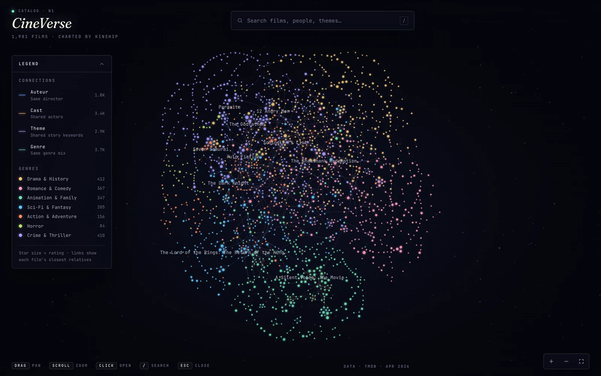
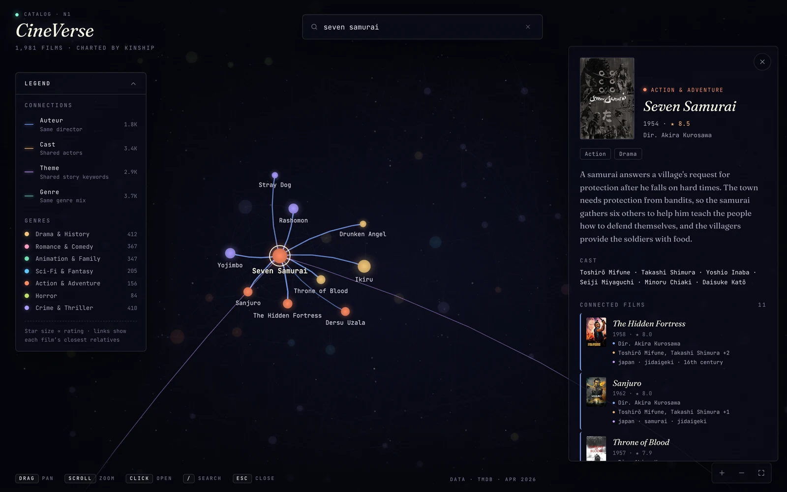

# CineVerse

An interactive star map of ~2,000 of TMDB's top-rated films. Each star is a film, and films sit next to the films they are most like: the same director, a shared cast, the same story themes. Search, filter, and click a star to see *why* its neighbors are its neighbors.

**Live demo:** https://rinshannkaihou.github.io/movie_visualization/



## What it does

- Lays out 1,981 films as a galaxy whose "continents" are genre families, with tight constellations for auteurs and franchises (Kurosawa, Miyazaki, Nolan, Tarantino…).
- Links films by **director**, **cast** (top billing counts more), **theme** (shared TMDB story keywords, weighted by rarity), and **genre**.
- Selecting a film flies to its neighborhood and explains every link — e.g. *The Hidden Fortress: Dir. Akira Kurosawa · Toshirō Mifune, Takashi Shimura · jidaigeki*.
- Search covers titles, directors, cast, keywords, genres, and years, accent-insensitively (`amelie` finds *Amélie*).
- Works on phones (details become a bottom sheet), supports keyboard use (`/` search · `Esc` close · `+` `−` `0` zoom), and honors reduced-motion settings.



## Running locally

Requires Node.js ≥ 22.18 (the data scripts are TypeScript run directly by Node).

```bash
git clone https://github.com/RinshannKaihou/movie_visualization.git
cd movie_visualization
npm install
npm run dev
```

The dataset is committed, so no API key is needed to run or deploy the site.

## Refreshing the data

```bash
cp .env.example .env     # set TMDB_API_KEY (v3 key or v4 read access token)
npm run data:fetch       # TMDB → data/movies.json, ~1 minute
npm run data:build       # graph + layout → src/generated/dataset.json
```

`data:build` is offline and deterministic, so you can tune the graph or layout without refetching. `npm run data:build -- --preview layout.png` renders the layout to an image.

The key is only ever read by `data:fetch` in Node. Don't rename it to `VITE_TMDB_API_KEY`: Vite inlines `VITE_*` variables into the public JavaScript bundle.

## How it works

1. **Fetch** (`scripts/fetch-movies.ts`) pulls top-rated movies plus credits and keywords, eight requests at a time with rate-limit backoff, into a canonical `data/movies.json`.
2. **Build** (`scripts/build-dataset.ts`) scores every pair of films that share something and keeps each film's strongest neighbors. A seeded d3-force layout then runs once, and the result is written as a compact dataset (~410 KB gzip) with positions baked in. Film overviews go in a separate ~220 KB file that the app loads after the first frame.
3. **Render** (`src/render/StarfieldRenderer.ts`): Pixi.js draws the stars and ~6,600 hairline edges with WebGL and only redraws when something changes, so an idle tab costs nothing. Filters and zoom levels toggle prebuilt edge layers instead of rebuilding geometry, and a Flatbush R-tree handles pointer picking.

Shared logic in `src/core/` runs unchanged in the browser, in the Node scripts, and in tests. See [`CLAUDE.md`](./CLAUDE.md) for details.

## Scripts

| Command | Purpose |
| --- | --- |
| `npm run dev` | Vite dev server with HMR. |
| `npm run build` | Type-check (`tsc -b`), then production build. |
| `npm test` | Vitest, single pass (`npm run test:watch` to watch). |
| `npm run lint` | ESLint. |
| `npm run data:fetch` | Fetch films from TMDB into `data/movies.json` (needs `TMDB_API_KEY`). |
| `npm run data:build` | Rebuild graph, layout, and `src/generated/dataset.json` offline. |
| `npm run deploy` | Publish `dist/` to GitHub Pages. |

## Acknowledgements

<a href="https://www.themoviedb.org/"></a>

This product uses the TMDB API but is not endorsed or certified by TMDB. Film data and posters © [The Movie Database (TMDB)](https://www.themoviedb.org/).

## License

MIT — see [`LICENSE`](./LICENSE).
